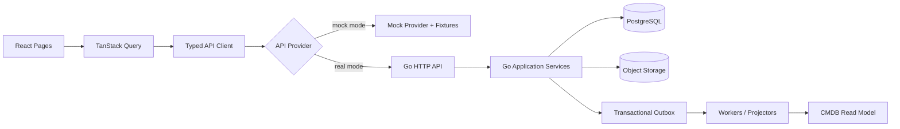

# keel Architecture Plan

## 1. 目标

使用 Go 构建后端模块化单体，React + TypeScript + shadcn/ui 构建 Web 控制台。以 PostgreSQL 为业务状态事实源、对象存储保存原始文件/产物、异步队列执行长任务。先清晰分层，不为“微服务化”而拆服务；当独立扩缩容、隔离或团队边界有真实需求时再拆分。

## 2. 逻辑架构

```text
React + TypeScript + Vite + shadcn/ui
       | REST JSON / SSE / WebSocket（仅需要实时流时）
Go API / Middleware
  ├─ Identity & RBAC
  ├─ Project & Template
  ├─ BOM Import (Excel parser adapter + AI mapper + validator)
  ├─ BOM / Inventory / Device Model
  ├─ Fabric / Network Baseline / PushJob
  ├─ PXE / Redfish / Mapping / GateEvidence
  ├─ Flow / Execution / Lease / Outbox
  ├─ ConfigSet / Media / Parameter Catalog
  ├─ Test / Monitoring / Issue / CMDB
  └─ Audit / Notification / AI troubleshooting
       |             |               |
 PostgreSQL       Object Storage    Queue/Workers
       |             |               |
 Outbox/State   raw XLSX/CSV/logs   parser/AI/device jobs
```

## 3. 代码组织建议

```text
cmd/api/main.go
cmd/worker/main.go
internal/
  auth/ rbac/ projects/ templates/
  bom/{domain,service,repository,parser,mapping,validation,packageio}/
  inventory/ devicemodel/ fabric/ networkbaseline/
  pxe/ redfish/ mapping/ gates/ configset/ media/ catalog/
  flow/ execution/ lease/ outbox/ tests/ monitoring/ issues/ cmdb/ audit/
  transport/http/{handler,middleware,request,response}/
  platform/{postgres,objectstore,queue,clock,logger}/
api/openapi.yaml
migrations/
web/src/{app,routes,features,components,lib,types}/
sim/device-sim/
tests/{contract,integration,e2e,golden}/
```

按业务域组织，不按 controller/service/model 等技术层建立一个横跨全仓库的大目录。域内部可采用 handler → application service → domain → repository/adapter 分层。

## 4. 关键技术决策

- 后端：Go，HTTP router 选用项目现有框架；若从零开始，可用标准库 `net/http` 或轻量路由。不要引入多个重叠框架。
- 前端：React + TypeScript + Vite；shadcn/ui 组件源码纳入仓库，Tailwind CSS，React Router，TanStack Query；表单用 React Hook Form + Zod；大型表格采用虚拟滚动。
- 数据库：PostgreSQL；JSONB 仅用于来源/设备原始属性等弹性字段，关键关系使用明确列和外键。
- 迁移：版本化 SQL migration；禁止应用启动时自动破坏性重建表。
- 文件：MinIO/S3 兼容对象存储；原始文件只读保存，派生数据按版本另存。
- 长任务：持久化 Job + worker + Outbox；Redis 可用于缓存/短期协调，但不作为业务状态权威源。
- AI：通过 `LLMProvider` 适配器封装可替换模型 API。模型只返回候选字段映射/解释；所有输出经 Schema 和领域校验。模型超时/不可用时可继续用已批准映射和规则处理，未知映射进入人工审核。
- 网络设备：统一 `DeviceAdapter` 契约，支持 SSH/CLI、Redfish、模拟器与第三方适配器。能力不支持必须返回 `unknown/unsupported`。
- 事件：业务状态和 Outbox 在同一 DB 事务提交；消费者按 event_id 幂等；外部执行通过 execution attempt/lease 关联。

## 5. 核心不变式

1. `bom_item` 是服务器与网络物料唯一事实源。
2. 原始开局文件不可变；映射、修正、标准 BOM 和每次提交都可追溯到原文件单元格。
3. AI 不能直接提交正式 BOM、发布模板、审批或下发配置。
4. 标准 BOM 包的 server/fabric 数据同一批次、同一事务提交。
5. 关键关系缺失/歧义或 BLOCK 存在时不能提交。
6. 任何生产网络变更均经过校验、审批、备份、下发和复采。
7. GateEvidence 的 `unknown`、过期或缺失不能当 PASS。
8. 数据库为状态权威源；消息队列和缓存不能取代持久化状态。
9. 外部副作用任务超时后先对账，不自动盲目重放。
10. 稳定 ID 不因机柜位置、hostname 或项目变化而变化。

## 6. BOM 智能导入组件

`UploadHandler` → `FileSafetyScanner` → `WorkbookParser` → `SourceCellStore` → `MappingResolver` → `LLMMappingAdapter`（仅未命中规则时）→ `Canonicalizer` → `ValidationEngine` → `ReviewService` → `PackageBuilder` → `BOMCommitService`。

`MappingResolver` 优先级：已审批模板规则 > 确定性规则 > AI 候选。每个候选保存 source file hash、sheet/cell、原值、target field、转换器版本、模型/提示版本（若调用模型）、理由、置信度和审核状态。任何数据修订都增加 draft revision 并重跑受影响校验。提交时校验 revision 未变化，使用事务写入批次、BOM 物料、关系、映射版本引用与审计记录。

原始 XLSX 安全规则：限制扩展名/大小/Sheet/行列数；拒绝宏执行、外链访问、路径穿越与压缩炸弹；不在服务端执行公式；公式单元格同时记录公式和可用缓存值，缓存缺失则标 unknown 并提示审核。AI 请求只发送必要字段上下文，按企业数据策略脱敏。

## 7. 数据分层

- 原始层：原始文件、设备原始 JSON、日志、原始命令输出；不可变、按 hash 追踪。
- 标准层：BOM、DeviceModel、PhysicalPort、Cable、Template、ConfigSet 等规范化实体。
- 执行层：Flow、Execution、TaskAttempt、PushJob、Lease、GateEvidence、Issue。
- 证据层：采样数据、StepReport、测试报告、审批、导出清单及其引用版本。

## 8. 部署与可观测性

开发期通过 Docker Compose 启动 API、worker、PostgreSQL、Redis（如需要）和 MinIO。生产部署按实际环境决定容器编排，不在 PRD 阶段假定 Kubernetes 是必需项。提供 `/health/live`、`/health/ready`、结构化日志、request_id、trace_id、任务指标、队列积压和失败率。秘密来自环境变量/Secret Manager，不进 Git。

## 9. ADR 必须记录的决策

- ADR-01 模块化单体与域边界。
- ADR-02 BOM 唯一事实源与稳定身份。
- ADR-03 原始资料导入和 AI 仅候选输出。
- ADR-04 Outbox、幂等与副作用任务对账。
- ADR-05 证据四值结论和门禁不可绕过。
- ADR-06 API 版本、错误结构和异步 Job。
- ADR-07 设备适配器与 simulator/golden contract。

## 10. 前端先行与 Mock-first

### 10.1 请求链路



- 所有页面先通过同一 API interface 实现；mock/HTTP provider 不改变页面调用方式。
- 当前 mock 数据集中在 `keel-demo/fixtures/demo-full-64-b300/`，由 `keel-demo/src/lib/api` 按 domain 提供场景；不得在 React 页面组件内写大段静态假数据。
- OpenAPI 是 wire contract；前端类型由 OpenAPI 生成或通过 CI 校验，不手工维护第二套枚举。

### 10.2 工作流执行边界

Flow 首期定位为“面向已纳管服务器/交换机的批量脚本执行和运行监控”，交互参考 Kestra Flows/Executions：Flow definition、Execution lifecycle、task attempts、Gantt/Topology、目标矩阵、实时/历史日志、outputs、重试、暂停/继续/终止。平台复用 Kestra 的成熟交互模式，不复制代码，也不将通用编排引擎、复杂可视化 DAG 编辑器作为首期阻塞。

### 10.3 CMDB 自动投影

业务表是写入事实源，CMDB 是统一资产/关系/生命周期查询投影。每个改变资产或交付状态的事务同时写 Outbox event；projector 按 `event_id` 幂等消费并维护 CMDB entity、relationship、timeline 和 provenance。导入任务创建时即记录 source file/import event；之后 BOM、采集、Flow/Execution、GateEvidence、ConfigSet/PushJob、Issue、TestReport、Approval、CleanupRun 全部自动关联。失败可重试/重放；不得要求用户手工把每个模块的数据“再录一次 CMDB”。

### 10.4 规划仓库结构增补（非当前目录迁移要求）

以下 `web/` 与 `api/` 是早期目标结构。当前前端实际位于 `keel-demo/src/`，契约为 `keel-demo/docs/openapi.yaml`，根 `docs/` 为同步镜像；不为了开始 Go 开发移动或重写已实现页面。业务 fixture 只从 `keel-demo/fixtures/demo-full-64-b300/` 读取，Provider 位于 `keel-demo/src/lib/api/`。

```text
web/src/
  app/ routes/ layouts/
  features/{bom,cmdb,flow,executions,fabric,servers,gates,issues,monitoring,settings}/
  components/{ui,shared}/
  lib/api/{contracts,client,providers}/
  mocks/{fixtures,scenarios,handlers}/
  types/ generated/
api/openapi.yaml
internal/{bom,cmdb,flow,execution,device,gate,fabric,issue,audit}/
internal/platform/{postgres,objectstore,queue,outbox,clock,logger}/
```

## 11. Rack Diagram 自动生成域

- 模块：`rackdiagram/{domain,service,generator,validator,renderer,repository,export}`；与 BOM/CMDB/DeviceModel 通过接口依赖，不复制资产身份。
- 生成输入冻结 `bom_revision_id`、`model_catalog_revision`、`placement_policy_revision`；输出 `RackDiagramRevision` + issue + content hash。Go 后端负责确定性生成/校验/版本/授权；React 负责 SVG 画布交互与草稿编辑。
- 前端参考 Rackula 的画布、缩放、拖放、撤销/重做、正反面与导出体验；参考 RackView 的真实资产/端口/线缆关联、查找、冲突检测和活动日志。只学习交互与业务方法，不复制代码或把两个项目作为依赖。参考链接见 `RACK-DIAGRAM.md`。
- 机柜图是 BOM/CMDB 的派生视图；经批准的放置变更必须更新权威位置记录并产生 Outbox 事件。无法确认位置的设备只进入 planned/未分配清单。
- SVG 为首期渲染格式，单机柜独立渲染；PNG/PDF 导出由隔离的渲染器/worker 执行，避免阻塞 API。不得把原始 XLSX 或敏感列直接提供给浏览器渲染。

## OPS-2026-10-29 · 交付后运维设计增补

运维域加入现有Go模块化单体：operations（维护与生命周期协调）、collection（策略/Job/适配器）、configuration（基线/意图/实测/diff）、firmware（部件库存/批准升级）复用inventory/fabric/monitoring/issues/lease/audit/outbox，不为每类遥测拆微服务。

数据链路：UI typed provider → 运维查询/命令服务 → 权威业务表+事务Outbox → 幂等CMDB投影；collector经CapabilityRegistry与AccessPolicyGate选择允许的适配器；MetricStore/LogStore独立查询，ObjectStore存不可变原文。PostgreSQL保存关联/索引/任务/版本，CMDB不承载全部样本。

资产身份/关系以CMDB统一注册与查询，BOM作为原始/标准物料来源，业务域负责各自事实。Machine=server Device，Switch=switch Device，Component=BOM子物料，不复制实体。ConfigBaseline与ConfigRevision是已有网络/服务器基线的统一接口视图，非重复正文存储。

AccessPolicyGate必须在创建、执行、重试、fallback、推送接入和恢复阶段检查。maintained仅IPMI-only；不允许通过Flow、外部控制器或采集器代理恢复SSH/Agent/Redfish。不能采集时返回原因与历史观测。时序/日志产品选择、采样和容量策略按部署评审决定，保留现有数据库技术。
详细存储/所有权矩阵见DATA-DICTIONARY运维增补；页面/API先Mock后Go，见OPERATIONS-DESIGN.md。

## IA v2.3 · 双平面与统一抽屉

前端新增单一 ProjectContext、URL projectId 路由守卫、每标签页内存作用域、TanStack Query 和可取消请求/订阅。部署 query key 含 projectId+permission revision；运维 query key 含授权项目集合+可清除过滤。SSE 带 Last-Event-ID、重连补齐与逐次鉴权。保留现有Go模块单体和 Outbox，不新建微服务；具体注册表与频率见 IA-V2.3.md。

## IA v2.4 实施增补

双平面ProjectContext、TanStack Query、按作用域取消请求/订阅、授权集合缓存与SSE恢复见IA-V2.4；不引入真实设备后端。


## IA v2.4 Mock 前端实施记录

导航树、完整页面清单、路由/权限/作用域/加载策略、五/八Tab抽屉与API对照统一见 [IA24-IMPLEMENTATION-MATRIX.md](IA24-IMPLEMENTATION-MATRIX.md)。原FR-0…24、门禁、BOM与维护态规则保留。当前实现为前端Mock，不表示已实现Go/真实设备/真实AI。权威种子为 `fixtures/demo-full-64-b300/demo-seed.json`；原包83集合，补齐与规范化后集合数量以当前manifest为准，主项目硬件数量不变。结构检查、数据修复、契约与交互结果以IA24-*报告为准，无法采集/缺少证据保持unknown或阻断。


## 当前六阶段主链路修正

本轮用户明确废弃数字门禁作为主链。当前唯一业务顺序、状态机、逐目标放行、安全交接、独立BOM菜单与API约束以[DELIVERY-LIFECYCLE.md](DELIVERY-LIFECYCLE.md)为准。历史编号只按[DELIVERY-MIGRATION.md](DELIVERY-MIGRATION.md)追溯，不得用于解锁。验机失败关联统一Issues并定向复验；NCCL不反写验机；清理/归档/客户签署齐全后才进入维护态。NP仍是网络内部断言。当前仅前端Mock与契约实现，没有真实设备后端。


## Fabric Topology 增补

Topology查询投影不持有第二套Device事实。物理视图组合BOM/Cable/PhysicalPort与LLDP/接口/DDM；逻辑视图组合批准规划、独立observed配置、BGP。Typed Mock Provider隔离数据源；按需Query支持AbortSignal、作用域key、分组及cursor渐进展开。Go接入在用户确认前端后逐模块实施。

完整导航、模型、交互、API表与实施边界见[FABRIC-TOPOLOGY.md](FABRIC-TOPOLOGY.md)。


## 无损网络分层证据 v2

集中LosslessProvider/typed envelope及纯规则器，四处UI共用判据；Go和真实collector尚未接入。当前分层帧解析只认证合成格式，不声明原生NVUE字段解析通过；只读command allowlist不包含clear/set/action。历史拓扑不显示当前无损结果冒充历史。

规则/官方章节/命令/版本/判据/证据对照、历史迁移、真实缺口见[LOSSLESS-EVIDENCE.md](LOSSLESS-EVIDENCE.md)。

## BOM 真实开发增补

用户已授权在 `dev/` 真实实现 BOM 模块。数据与权限边界、版本/审核/Outbox、真实六步工作台及运行验收统一见 [BOM-REAL-DESIGN.md](BOM-REAL-DESIGN.md)。FR-2.1 和唯一 BOM/资产身份保持；其他模块的 Mock 状态不因本模块接入而视为后端已完成。实际通过范围以 BOM-REAL-ACCEPTANCE.json 为准。

## 2026-10-30 · 统一身份边界

dev 的 Go 模块化单体增加 internal/identity，复用 PostgreSQL 与已有 api_session/audit_event。统一 Cookie Session → 主体加载 → 项目/资源权限 → 业务 Handler；BOM 不再维护独立身份。前端统一 IdentityProvider 在 ProjectContext 之前安装后端授权快照，Mock 只消费该授权的读投影。完整边界见 IDENTITY-RBAC.md；设备域仍为 Mock。

## CMDB 真实服务边界

Go模块化单体中internal/cmdb包含Schema、Domain、Query和ChangeSet服务；演进既有cmdb_entity/cmdb_relationship，不新建平行资产库。PostgreSQL外键/邻接索引实现图关系，GraphRepository仅预留适配边界。MinIO存领域证据原文，CMDB存引用。现有Outbox同事务发布，前端API Adapter不改变组件结构。

接口对照、模型与实现边界统一见 [CMDB-REAL-DESIGN.md](CMDB-REAL-DESIGN.md)，具体HTTP Schema以openapi.yaml为准。

## 项目与 AI 配置真实落地

项目与AI配置由既有Go模块化单体实现。Provider元数据在PostgreSQL、凭据为独立受控引用；统一Adapter支持openai-chat与keel-mapping，前端不直连供应商。

唯一详细说明与API对照见 [PROJECT-AI-CONFIGURATION.md](PROJECT-AI-CONFIGURATION.md)。
