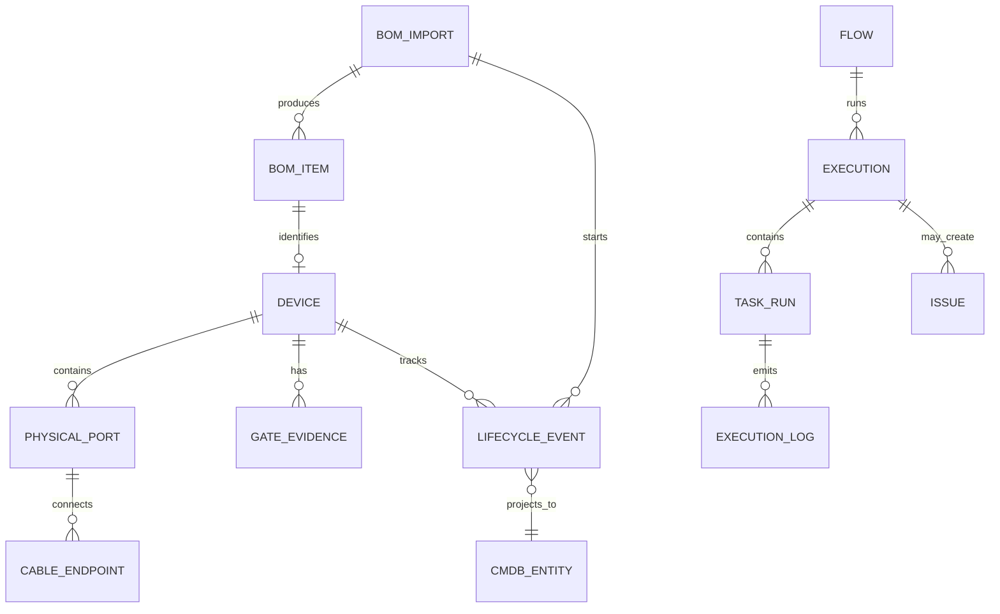

# DATA-DICTIONARY.md — 核心数据契约

> 本文定义开发时必须共享的核心实体、身份和关系。PRD 中的完整 `bom_item` 字段表与 CSV 列契约仍是 BOM 字段的业务依据；如本文件与 PRD 不一致，以 PRD 为准并登记冲突，不得自行扩字段改变语义。

## 1. 通用约定
- 主键使用稳定内部 ID；面向用户的业务码只用于展示，不作为关系键。
- 所有可变业务对象含 `created_at`、`updated_at`；需要审计的变更额外记录 actor、request_id、before/after、reason。
- 时间统一存 UTC RFC 3339；API 输出 ISO 8601 UTC 时间。前端按用户时区展示。
- 枚举值使用小写 `snake_case`，除 PRD 已定义的大写状态机外，不创建同义枚举。
- JSONB 只用于确有弹性需求的原始属性/模型输出；核心关联、唯一性和状态使用显式字段与约束。
- 不把秘密值放进实体快照；只存 Vault/Secret Manager 引用与版本。

## 2. 核心实体

| 实体 | 主键/身份 | 关键字段与关系 | 约束 |
|---|---|---|---|
| Project | `project_id` | `project_code`, `template_revision_id`, `status` | 所有读写按项目授权范围隔离 |
| ProjectTemplateRevision | `template_revision_id` | 型号选择、服务器/网络基线引用、BOM 映射、参数默认值、Flow 蓝图、门禁策略 | 发布版本不可原地修改；变更产生新版本 |
| SourceDocument | `source_document_id` | `project_id`, `file_hash`, `object_key`, `uploaded_by`, `template_revision_id`, `status` | 原始对象不可变；hash 用于完整性/重复识别，不代替业务批次唯一键 |
| SourceCell | `source_cell_id` | `source_document_id`, `sheet_name`, `cell_ref`, `raw_value`, `formula`, `cached_value`, `header_context` | 可追溯到原文件位置；不把公式执行作为解析行为 |
| FieldMappingRevision | `mapping_revision_id` | source header/pattern、target field、transformer、scope、version、approval | AI 生成的候选不是已批准映射；批准后才可复用 |
| BOMImportBatch | `bom_import_batch_id` | project、seq、content hash、template revision、state、counts、committed revision | 同批次同摘要幂等；同批次异摘要冲突 |
| BOMImportIssue | `issue_id` | import id、severity、rule_id/version、file/sheet/row/field/cell、raw/expected、resolution | `BLOCK/WARN/INFO`；不得静默丢弃未知列 |
| BOMItem | `item_uid` | `category`, `sub_type`, `model_version_ref`, `serial`, `parent_uid`, `position`, `rail/pod/role`, `mac_list`, source/status | 服务器和网络物料统一事实源；详细字段以 PRD 附录 A.1 为准 |
| DeviceModelRevision | `model_version_ref` | vendor/model/kind/version/capability matrix | 仅引用已发布版本；能力未知时不得假设支持 |
| NetworkBaselineRevision | `network_baseline_revision_id` | source_ref、approved evidence、baseline content/version | 仅承载客户/网络工程师商定内容；草稿不能用于生产下发 |
| PhysicalPort | `physical_port_uid` | parent item、physical position、port index/name、role | `(parent_uid, port_index)` 唯一；breakout 子口独立 |
| Cable | `item_uid` | endpoint A/B port UID、cable type | 两端必须唯一解析；无序端点对唯一 |
| GateEvidence | `evidence_id` | subject、gate_id、verdict、rule revision、source、observed_at、valid_until、refs | verdict 仅 `PASS/FAIL/BLOCKED/WAIVED`；过期/缺失不能放行 |
| MappingRevision | `mapping_revision_id` | BOM revision、GPU/NIC/port/switch relations、approval | 发布后不可变；重新映射生成新版本 |
| FlowRevision | `flow_revision_id` | flow definition、version、schema、status | 已发布版本不可就地编辑 |
| Execution | `execution_id` | project、flow revision、target snapshot、parameter snapshot、state | DB 是状态权威源；事件/队列不取代 DB |
| TaskAttempt | `task_attempt_id` | execution、task、attempt number、result, logs refs | 消费者幂等；副作用不明时 `result_unknown` |
| PushJob | `push_job_id` | intended revision、target set、diff, approvals, state | 状态机以 PRD 为唯一来源；未审批不得执行 |
| ApprovalRecord | `approval_id` | object/version、actor、role、decision、reason、timestamp | 审批绑定具体冻结版本/目标范围 |
| AuditEvent | `audit_event_id` | actor、project、action、resource、request_id、result、safe diff | 追加写；不得记录密码/token/私钥 |
| Issue | `issue_id` | source domain、object refs、T1–T7、evidence refs、state | 处置后按受影响对象定向复验 |
| MediaArtifact | `media_artifact_id` | version、sha256、compatibility metadata、approval/status | 仅批准且未退役介质可用于执行 |
| Lease | `lease_id` | resource key、owner、fencing token、expires_at | 独占操作检查 token 与租约有效性 |

## 3. BOM 身份规则

- 有序列号实体：`(category, serial)` 唯一，适用对象范围按 PRD 附录 A.2。
- 端口：`(parent_uid, port_index)` 唯一。
- 线缆：`(category, sorted(endpoint_a_uid, endpoint_b_uid))` 唯一。
- `bom_line_no` 仅用于来源追踪和错误定位，不参与物料身份判定。
- `item_uid` 不因机柜位置、hostname、项目归属改变而变化。RMA 新实物使用新 UID，旧身份保留历史。
- 物料类别至少包含 `server/nic/gpu/psu/bmc/switch/port/optic_module/cable/other`。

## 4. BOM 导入状态

导入状态：`UPLOADED → PARSING → MAPPING → VALIDATING → REVIEW_REQUIRED | READY_TO_COMMIT → COMMITTING → COMMITTED`；失败/取消为终态或按实现规则记录。状态只由后端转换。

规则：
- 修正后生成新的 draft revision，并重跑受影响的校验。
- 提交时检查待提交 revision 未变化；数据、版本引用和审计在一个事务中提交。
- `BLOCK` 不清零不得提交；关键身份、端口、链路歧义不得自动放行。
- 标准包中服务器和网络物料同批次、同事务提交。

## 5. 状态机引用

不要在本文件复制完整状态转换表。唯一来源：
- BOM 导入：`SYSTEM-DESIGN.md §3` 与 `PRD.md FR-2.1`
- GateEvidence/NP：`PRD.md §5`
- PushJob：`PRD.md FR-0` 与 `SYSTEM-DESIGN.md §7`
- Flow/Execution：`PRD.md FR-1` 与 `SYSTEM-DESIGN.md §8`

若数据库枚举、Go 常量、前端联合类型或 OpenAPI enum 不一致，视为契约缺陷，修复后才能合并。

## 6. CMDB 全链与 Flow 执行实体

### 6.1 Flow/Execution
- `Flow`: 定义和版本，不等于一次运行。
- `FlowRevision`: 不可变脚本/参数/策略版本。
- `Schedule`: 频率、时区、启停与 next/last run。
- `Execution`: 一次运行，冻结 FlowRevision、目标快照、参数快照、触发源和操作者。
- `TaskRun` / `TaskAttempt`: 按步骤/目标记录状态、耗时、退出码和重试。
- `ExecutionLog` / `ExecutionArtifact`: 日志和产物，按需分页/下载。

### 6.2 CMDB 投影
- `CMDBEntity`: 稳定实体引用、类型、当前态、项目范围、来源事件、投影状态。
- `CMDBRelationship`: from/to、关系类型、来源事件、有效时间。
- `LifecycleEvent`: 实体状态变化、操作者、来源域、来源引用、版本引用。
- `CMDBProjectionCheckpoint`: 消费游标/失败状态/最后成功时间，用于监控和重放。

### 6.3 全链关联关系

CMDB 是投影/查询模型；不要让多个模块直接重复写入同一 CMDB 当前态。业务事务写 Outbox，projector 幂等消费。原始敏感文件只保存受控对象引用，不把秘密复制进 CMDB。

## 7. Rack Diagram 数据契约

| 实体 | 主键 | 关键字段 | 约束 |
|---|---|---|---|
| Rack | `rack_id` | project/site/room/name/u_height/position/source_item_uid/status | 高度必须有来源；与 BOM/CMDB 资产关联 |
| RackPlacement | `placement_id` | rack_id/item_uid/u_start/u_height/face/status/manual_override/source_ref | U 位合法且不冲突；full-depth 前后面指向同一设备 |
| RackDiagram | `diagram_id` | project/scope/current_revision_id/status | 项目范围隔离 |
| RackDiagramRevision | `revision_id` | BOM/model/policy/generator versions/content_hash/status | 不可变；生成相同输入摘要稳定 |
| RackDiagramIssue | `issue_id` | revision/item/rule/severity/source_ref/resolution_status | 问题可追溯来源并可导出 |
| RackLayoutEvent | `event_id` | actor/action/before/after/reason/request_id | 发布、移动、重生成和导出进入审计/CMDB 时间线 |

布局状态使用 `planned/review_required/approved/as_built` 表达事实成熟度；不得将 planned 误标为 as_built。完整字段与状态规则以 `RACK-DIAGRAM.md` 为准。

## OPS-2026-10-29 · 交付后运维设计增补

### 复用与领域所有权矩阵
| 契约对象 | 复用/所有者 | 关键字段与关联 | 版本/保留 |
|---|---|---|---|
| Machine / Switch / Component | Inventory/BOM；分别是Device.server、Device.switch、BOM子物料视图 | Device.id与item_uid稳定映射；project_id、parent_asset_id、model_revision_id | 不新建平行资产表；RMA新ID；历史引用保留 |
| PhysicalPort / Rack / RackPlacement / Cable | 复用既有物理实体 | asset_id、端口父子/线缆端点、来源BOM | 身份不随OS接口名/U位改变 |
| ConfigBaseline / ConfigRevision | 配置域；复用NetworkBaselineRevision/ConfigSetRevision的统一引用 | id、asset/project/scope、kind、revision、approval_refs、content_hash、payload_ref | 发布不可变；被引用版本不得提前删 |
| IntendedConfig | 配置域 | baseline_revision_id、template_revision_id、target_snapshot_id、render_context_hash、payload_ref | 渲染新版本；绑定精确目标 |
| ObservedConfig | 采集域写入，配置域查询 | asset_id、snapshot_id、collection_job_id、format(running/nvue/server_inventory)、hash、ObservationContext | 只读追加；原文按策略保留 |
| ConfigDiff | 配置域 | baseline/intended/observed refs、rule_revision、drift_level、verdict、items(path/expected/actual)、context | 任一输入变化重新计算与审批 |
| ObservationContext | 共享值对象，非资产表 | project_id、asset_id、source、adapter_version、collected_at、received_at、capability_status、freshness_status、quality_status、policy_allowed/reason、threshold_revision_id、retention_policy_id | 快照不可变上下文；失败不刷新成功时间 |
| MetricSample | Monitoring/MetricStore | metric_key、value(nullable)、unit、labels、snapshot_id、counter_reset、context | 时序窗口/降采样/归档由批准策略定义 |
| TelemetrySnapshot | Collection/对象存储+索引 | snapshot_id、asset_id、kind、payload_ref/hash、context、data_availability | 原文不写入CMDB普通属性 |
| LLDPSnapshot | TelemetrySnapshot特化 | local_port_id、peer_asset_id/port、chassis_id、port_id、sysname、sysdesc、expected_peer、verdict | 原始邻居值不是资产身份自动更改 |
| FDBSnapshot / ARPSnapshot | TelemetrySnapshot特化 | MAC/VLAN/port/type/learned_at；IP/MAC/VLAN/VRF/interface/state | 快照与采样时间分开，按资产+时间分页 |
| DDMSnapshot | TelemetrySnapshot特化 | port_id、optic_asset_id、channel、rx_dbm/tx_dbm、temperature_c、voltage_v、bias_ma、vendor/model/serial_redacted、threshold refs | nullable量值+单位；阈值按型号/方向/通道 |
| LogEvent | LogStore/Collection | asset_id、snapshot_id、timestamp、source、level、message_redacted、cursor、context | 独立检索；引用和legal_hold制约清理 |
| MaintenanceState | Operations协调Inventory/CMDB | asset_id、state、window、reason、issue/change/approval refs、access_policy(ipmi_only)、revision | 与Device生命周期正交；不因维修恢复通道 |
| FirmwareInventory | Inventory，采集更新 | component_asset_id、kind(BIOS/BMC/NIC/GPU)、observed_version、baseline_ref、compatibility、snapshot/context | 新观测新版本，不能手工改实测值 |
| FirmwareUpgradeJob | 复用Job/Execution，Firmware域 | target/component/media/baseline refs、approval_refs、lease_ref、access_policy_revision、before/after snapshot、verification_ref | 副作用未知先对账；不可自动刷写 |
| CollectionJob / CollectionPolicy | 复用Job/调度服务，Collection域 | scope/kinds/protocol/targets、schedule spec/timezone、timeout、retry、policy/freshness refs、attempts、last_success_at | 任务与策略分开；仅安全采集自动重试 |
| Alert / Issue / AuditEvent | 复用Monitoring/Issues/Audit | 稳定asset/project、source/snapshot/config/job refs、时间、规则/版本 | T1–T7沿用；关闭需证据；审计追加与脱敏 |
| RetentionPolicy | 平台配置 | category、scope、hot/archive/purge windows、legal_hold、approved_by、revision | 数值待确认；禁止默认删除引用证据 |

### 统一字段规则
所有运维资源都含稳定asset_id、project_id、id、source/time和revision或不可变snapshot引用。API资产ID指向Device.id/item_uid映射，CMDBEntity.stable_ref指回同一身份；不增加第三种Machine主键。配置正文、指标样本和日志通过artifact/snapshot/query refs关联CMDB。

能力supported/unsupported/unknown、保鲜fresh/aging/stale/unknown、质量good/degraded/failed/unknown分别定义；既有Device.freshness中legacy unsupported值在新运维契约适配为capability=unsupported，而不更改既有API枚举。门禁四值与PushJob原状态不变。具体wire字段以openapi.yaml的Ops*专用schema为准。

## IA v2.3 · 双平面与统一抽屉

ProjectContext 是前端每标签页会话值，不是数据库事实表；Session.permissions[]、authorized_project_ids、permission_revision由服务端授权产生。Drawer query 绑定 project_id、稳定 device_id、tab、版本及来源。跨项目关系仍通过现有 CMDB、BOM、PhysicalPort、Issue、Execution、Config 和事件ID引用，不复制资产。

## IA v2.4 实施增补

ProjectContext仅为标签页内状态；资产/端口/线缆/工单/Execution关联稳定ID与project_id，不另建平行资产；RackDiagram是CMDB位置投影。

## IA v2.4 Mock 前端实施记录

导航树、完整页面清单、路由/权限/作用域/加载策略、五/八Tab抽屉与API对照统一见 [IA24-IMPLEMENTATION-MATRIX.md](IA24-IMPLEMENTATION-MATRIX.md)。原FR-0…24、门禁、BOM与维护态规则保留。当前实现为前端Mock，不表示已实现Go/真实设备/真实AI。权威种子为 `fixtures/demo-full-64-b300/demo-seed.json`；原包83集合，补齐与规范化后集合数量以当前manifest为准，主项目硬件数量不变。结构检查、数据修复、契约与交互结果以IA24-*报告为准，无法采集/缺少证据保持unknown或阻断。

## IA24-05 · 用户确认的GPU-NIC默认映射
用户于本轮明确：没有单独说明时，GPU1–8分别对应NIC1–8。对当前B300切片按此规则确认512条GPU-NIC关系，NIC9/10保留存储角色；不再把已有LLDP链路显示成全部unknown。矩阵行GPU、列NIC，点击显示物理端口、线缆、交换机、来源与观测；配对关系与线序/新鲜度判据分开，异常不能被配对规则覆盖。

六阶段新增/迁移实体：DeliveryStageRecord（逐项目/设备/阶段）、DeliveryStageEvent（追加审计证据）、ValidationCheck（验机内部子任务）、DeliveryBatch（冻结目标与混合结果）、ProvisioningReceipt、ValidationRemediation、HandoverRecord。复用Device/Port/BOM/Issue/Execution，不建立平行资产。旧门禁和旧StepReport仅在legacy_*集合查询。

## 当前六阶段主链路修正

本轮用户明确废弃数字门禁作为主链。当前唯一业务顺序、状态机、逐目标放行、安全交接、独立BOM菜单与API约束以[DELIVERY-LIFECYCLE.md](DELIVERY-LIFECYCLE.md)为准。历史编号只按[DELIVERY-MIGRATION.md](DELIVERY-MIGRATION.md)追溯，不得用于解锁。验机失败关联统一Issues并定向复验；NCCL不反写验机；清理/归档/客户签署齐全后才进入维护态。NP仍是网络内部断言。当前仅前端Mock与契约实现，没有真实设备后端。

## 单柜详情工作区增补

固定单柜窄画布、左侧层级导航和右侧八Tab为本轮布局要求；交互、API、元数据、Mock来源及待执行验收见[RACK-WORKSPACE.md](RACK-WORKSPACE.md)。资产/位置和既有安全模型不变。右侧按需加载，不以缺失指标显示正常。当前构建/浏览器验证按用户安排等待统一执行。

## Fabric Topology 增补

复用Device/PhysicalPort/Cable/Rack稳定ID，不新增Machine/Switch身份。TopologyFabric、TopologyNetwork、TopologyMembership为版本化逻辑规划投影；TopologyObservedNetwork、TopologyBGPSession、TopologyPortObservation为独立观测；TopologySnapshot保存不可变来源切片。network_id、device_id、port_ids、baseline_id、source/time/freshness/support及revision必须可追溯。专用时序/日志仍通过资产关联，不塞入CMDB。

完整导航、模型、交互、API表与实施边界见[FABRIC-TOPOLOGY.md](FABRIC-TOPOLOGY.md)。

## 无损网络分层证据 v2

LosslessRule@version（历史映射）、LosslessProfile、LosslessBaseline、LosslessEvidence、LosslessRawOutput、LosslessHostEvidence、LosslessRetest引用既有项目/Device/PhysicalPort/Issue/Execution。计数十进制字符串保精度；boot/epoch/width/wrap、窗口、单位和来源显式记录；无原始值不补零。raw/旧窗口保留，新增窗口独立ID。

规则/官方章节/命令/版本/判据/证据对照、历史迁移、真实缺口见[LOSSLESS-EVIDENCE.md](LOSSLESS-EVIDENCE.md)。
