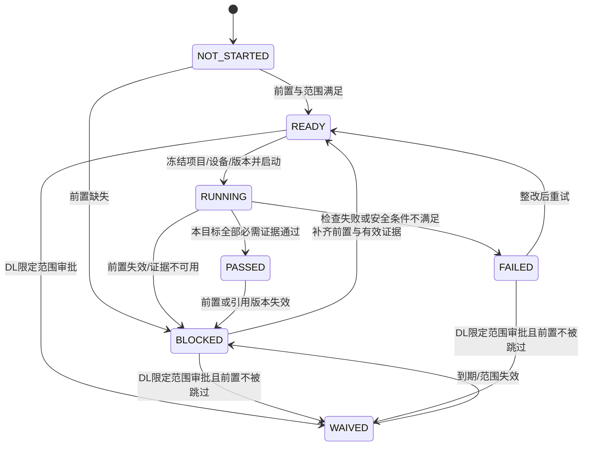

# 六阶段交付主链路（当前唯一有效设计）

本规范由用户本轮业务修正确认，取代旧数字门禁作为交付主链路的用法。全局IA保持部署/运维/系统三个区域；BOM从Provision移出，成为部署平面的独立菜单。

## 阶段、职责及前置

| 顺序 | stage_id | 名称 | 主要内容 | 解锁条件 |
|---|---|---|---|---|
| 1 | KICKOFF | 开局配置 | 网络/服务器Excel、AI候选、人工审核、标准BOM、资产关系、机柜规划、网络基线 | 已审核且无提交阻断；稳定身份与关系可解析 |
| 2 | NETWORK_READINESS | 网络就绪 | 交换机纳管、ZTP、渲染校验、审批下发、复采、端口/链路就绪 | 开局配置有效通过；NP-1/NP-2/NP-4满足，不依赖装机后的验机任务 |
| 3 | PROVISIONING | 装机 | PXE/OS、hostname、SSH互信、必要基础配置 | 网络就绪有效通过，开始前网络就绪证据在30秒TTL内；批准介质与目标范围已固定 |
| 4 | VALIDATION | 验机 | 硬件、GPU/NIC、PCIe、网卡/MAC、LLDP、DDM、配置一致性、必要RoCE子任务 | 装机通过；按设备/检查项保存Execution和证据；失败自动关联Issues |
| 5 | NCCL_VALIDATION | NCCL测试 | 批次、报告、基线与实际覆盖范围、测试证据 | 验机通过或合法限定豁免；验机工单已整改、定向复验并关闭；NP-5/NP-6满足 |
| 6 | CLEANUP_HANDOVER | 优雅退场 | 停止执行、临时资源清理、Agent/SSH撤销、凭据处理、日志证据归档、客户签署 | 前五阶段有效；结果未知先对账；全部安全步骤和客户签署完成后才进入maintained |

阶段标识不是检查项编号。硬件、NIC、线序、拓扑等为VALIDATION下的check_key；ConfigSet实施属于装机，配置一致性复核属于验机；NetTest是验机/网络领域支撑页面，不新增主阶段。

## 状态机

- 每条记录绑定project_id、device_id、stage_id、revision、evidence_refs、observed_at、valid_until、execution_ids。
- PASSED必须有本目标证据；不能用单设备或项目汇总替代其他目标。
- WAIVED有approved_by、reason、scope、valid_until、remediation_plan，并独立统计；不是PASSED。运行中的副作用不能直接豁免。BOM关键身份、清理安全步骤、凭据撤销和客户签署不能被豁免跳过。
- 开始新阶段逐个检查所有前序阶段。前序重新运行、失败或阻断时，后序失去当前放行资格，历史结果保留。
- 批次保存明确target_ids及版本；允许符合条件的目标启动，其余目标保留具体阻断原因。分别汇总PASSED、FAILED、BLOCKED、RUNNING、READY/NOT_STARTED、WAIVED，分母为真实冻结目标数。
- Mock的24小时演示证据有效期不代表生产默认策略；网络动态就绪仍严格使用已批准的30秒TTL。

## 验机与Issues闭环

每个检查项保存设备、端口、check_key、verdict、原始证据、来源/采集时间/能力/新鲜度和Execution。FAIL/BLOCKED自动关联统一Issues，沿用T1–T7，不建立平行工单。

流程：检查失败 → 工单关联设备/端口/检查项/Execution → 记录整改 → 显式Mock整改或受控处置 → 只重验受影响检查与目标 → 复验PASS → 工单关闭 → 重新验收该设备的验机阶段。尚有未关闭验机工单或失败/缺失/过期的必需检查，不能判验机通过。NCCL报告只写本阶段，不反向改变验机。

## 网络内部断言

NP-1：统一BOM链路建模；NP-2：ZTP与Golden无Critical漂移；NP-3：验机线序通过并写PortModel；NP-4：网络就绪证据30秒内且LLDP可读；NP-5：BGP/DDM健康及适用PTP证据；NP-6：无损基线可用。

NP-3由验机产生，不允许作为网络就绪或装机的先决条件，避免循环依赖。NP不是交付阶段。

## 路由与API

BOM独立入口`/p/:projectId/deploy/bom`及`/:importId`。旧`/deploy/provision/bom`重定向；Provision默认PXE。Validation使用`/deploy/validation/checks`，旧数字门禁页面重定向到检查页，不按旧编号解释新阶段。

统一API见OpenAPI的DeliveryStage*、ValidationCheck*、Handover*。阶段写入只接受start/complete/waiver等受控命令，不能PATCH status=PASSED。Mock与未来Go必须复用同一依赖、授权、幂等和版本语义。旧门禁API只提供明确deprecated的历史查询，旧写入口停止作为活动交付命令。

当前前端实现对应`src/lib/api/delivery.ts`、`StageWorkspace`、`DeliveryTimeline`，无真实设备或Go处理器。
