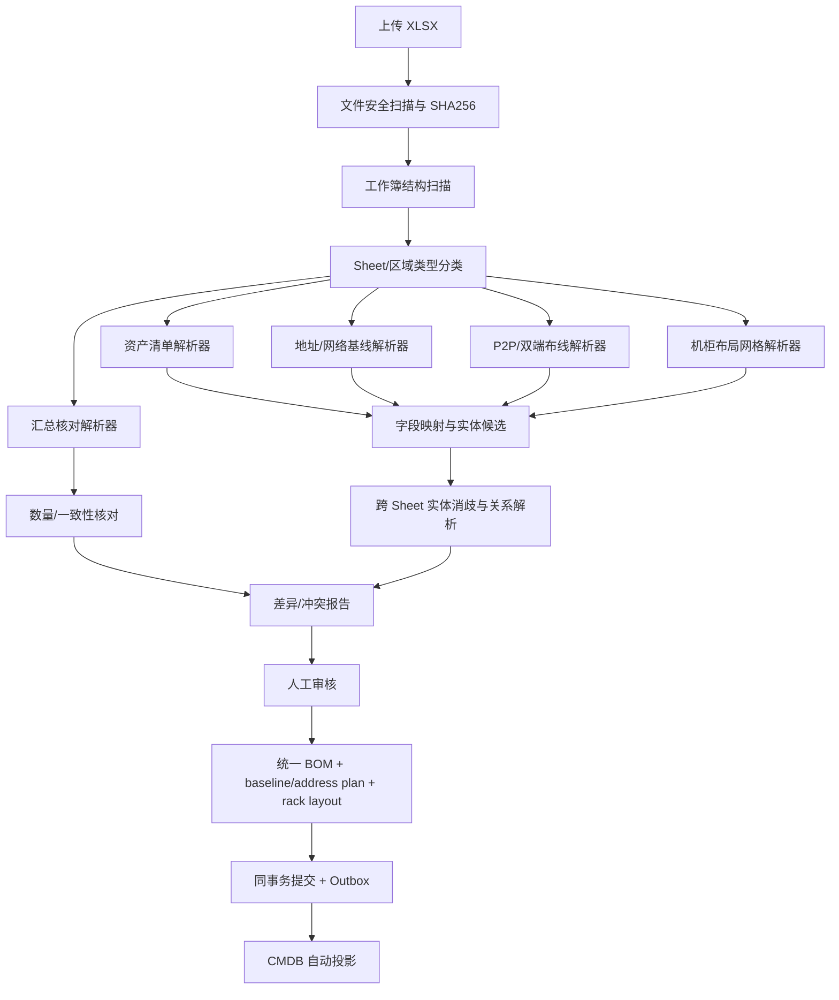

# 真实开局 Excel 导入规划：TX B300 Layout-new.xlsx

> 本文基于用户提供的真实工作簿结构分析。原文件不包含在文档包中。该工作簿存在账户/密码字段及明文凭据风险；本文件不复制任何凭据值。实现时必须先执行敏感字段隔离。

## 1. 结论：不能把整本 Excel 当成一张 BOM 表

工作簿包含 33 个 Sheet，既有设备清单、网络地址、P2P 连接表，也有机柜平面/立体布局、数量汇总、不同规模分片表和独立网络域表。部分 Sheet 是同一信息的分期/规模版本或汇总副本，不能把所有 Sheet 的行简单拼接，否则会重复建模。

**正确方式：先识别 Sheet/区域的语义类型，再使用对应解析器抽取候选实体，最后合并到统一 BOM + 网络基线/地址计划 + 机柜布局数据模型。** AI 用于识别类型与列语义，不负责猜测冲突事实。

## 2. 真实工作簿 Sheet 分型

| Sheet | 观察到的结构/列特征 | 处理策略 | 输出候选 |
|---|---|---|---|
| `Device Information` | 资产编号、设备角色、设备名、设备类型、品牌/型号、U 数、SN、GUID、机房/机柜位置 | 设备资产主表候选；按资产编号/SN/设备名建立候选身份，重复身份需跨表比对 | Device / BOMItem / RackPosition |
| `Switch 2K`、`GPU-TOKEN` | 与设备清单类似的资产字段，另有不同批次/用途信息 | 识别为资产清单变体；用 hash/字段签名和实体键识别与 Device Information 的重叠，不直接重复插入 | Switch/Device candidate + provenance |
| `Device OOB`、`Device OOB 2` | 归属、设备名、AS、Loopback IP、管理 IP，部分版本增加 Anycast SOO IP | 网络地址/设备属性表；以设备名候选关联资产表，冲突不自动覆盖 | NetworkAddress / NetworkBaseline reference |
| `P2P design`、`P2P design-1k` | 网络、A/Z 侧、两端设备、距离、线缆长度、带宽、线缆/光模块型号、数量及角色/机柜等混合列 | 连接设计主表候选；多行可能通过空白继承前一组设备/网络信息，必须实现分组填充并保留原坐标 | Cable/Link + endpoint ports + optics candidate |
| `Roce`、`Eth`、`SPX`、`ETH-2k`、`备线` | 两端设备、端口号/物理端口、接口类型、模块型号、线缆类型/长度；部分表多列组或额外校验字段 | 连接表分型；字段映射因表而异；按端点规范化后做去重和冲突检测 | Cable/Link + Port + OpticModule |
| `GPU`、`CPU`、`CPU2`、`MGT CPU`、`GPU-2k-*` | 左侧服务器/设备端口与右侧交换机端口信息并列；包含网络类型、槽位、端口、接口/模块型号、线缆类型/长度；不少记录使用空白延续上组 | 识别为“服务器/设备到交换机”布线矩阵；按组继承设备名/网络类型时必须保留原始空值与派生值，派生值标注 `derived_from_row` | ServerPort / SwitchPort / Cable / Rail relation |
| `Layout`、`Layout 110-120`、`Sheet1` | 以网格、行列、机柜/U 位、设备块和合并区域表示的布局信息；不是普通记录表 | 专用网格/布局解析器；记录坐标、合并区域、设备标签、机柜/行列关系；不能用普通 header mapping 强行解析 | RackLayout / RackUnit / placement candidates |
| `IT Power`、`IT Power (2)`、`工作量` | 数量、机柜数、每柜数量、功耗、网卡配置、线缆/设备数量等汇总 | 仅作为 reconciliation/check totals，不作为单台资产或线缆主记录；区分版本，不能重复生成 BOM | Summary / reconciliation checks |
| `SN5610`、`S9825-64D` | 独立型号/端口或配置相关工作表，结构需进一步根据非空行和合并区域解析 | 先识别为型号/端口能力或配置参考候选；只有经人工确认后才能进入型号库/模板 | DeviceModel/PortCapability candidate |
| `金石` | CCTV 设备连接表，含设备名、位置、端口、线号、IP，以及账户/密码列 | 与 B300 主要网络表隔离成独立子表区；敏感列立即剔除，不导入明文凭据；是否纳入当前项目范围需用户/项目负责人确认 | Cable/Device candidate；credential ref only |

## 3. 解析架构

## 4. 关键实现规则

### 4.1 工作簿预处理
- 读取 `data_only=False` 与 `data_only=True` 两个视图，保留公式文本和缓存值；不执行公式。
- 提取 Sheet 名、维度、合并区域、隐藏状态、非空单元格坐标、表头候选行、重复表头和区域边界。
- 清理只可用于匹配的空白/全角空格/换行；原始值必须保留，归一值单独存储。
- 空白继承（如同组后续行省略设备名）只允许在识别出分组结构后作为候选派生；必须保存来源行与派生规则，并在审核界面可见。
- 公式缓存不存在时标 `unknown` 并要求人工确认；禁止以 0 补值。

### 4.2 资产去重与身份消歧
- 优先级按项目已有身份契约执行：稳定 UID 不从名称生成；序列号/SN、资产编号、MAC/GUID 为候选自然键，具体唯一性按实体类别判定。
- 设备名仅作为可变属性/匹配线索，不可单独作为全球唯一身份。
- 同一设备在 Device Information、Switch 2K、GPU-TOKEN 中出现时，先生成跨 Sheet 候选匹配报告；不允许因 Sheet 重复而创建多台设备。
- 设备名称冲突、SN 不同但位置相同、位置变化、同一 SN 多个名称等均进入审核，不做静默覆盖。

### 4.3 连接关系解析
- 将每张连接表映射到统一端点结构：`endpoint_a_device_ref`、`endpoint_a_port_ref`、`endpoint_a_module_ref`、`endpoint_b_device_ref`、`endpoint_b_port_ref`、`endpoint_b_module_ref`、`cable_type`、`length`、`bandwidth`、`network_role`。
- 不同 Sheet 的列语义通过“表类型 + 列名 + 示例值 + 位置上下文”识别，不建立全局一对一的表头字典后就假定所有工作表一致。
- 空白端点字段只有在分组规则明确时才能继承；否则标 `BLOCK`/人工确认。
- 端口号、物理端口名、cage、槽位、breakout 子口分开保存；不能把“65”自动判断为端口编号还是 cage，需依表结构和同列样例确认。
- 同一端口被多个线缆引用、同一连接正反重复、两端设备无法匹配资产、模块速率/类型冲突均产生 Issue。
- 线缆长度单位统一到米，但原始值和原始单位必须保留；不确定单位不自动转换。

### 4.4 机柜布局解析
- `Layout`/`Layout 110-120` 是二维网格/布局类表，不应按常规 CSV 逐行导入。
- 先识别机柜/行/列/U 位坐标和设备标签区域，再把布局结果与设备清单中的位置字段做关联核对。
- 布局只能作为位置候选来源；与资产清单位置不一致时展示 diff，不自动决定哪一方正确。

### 4.5 汇总表核对
- `IT Power` 与 `IT Power (2)` 是两个不同版本的汇总，不得合并为同一份明细；`工作量` 等汇总用于检查服务器数量、交换机数量、端口/线缆计数、机柜数和功耗差异。
- 汇总数与明细数不一致时产生 reconciliation issue；汇总值不能自动补造缺失设备或线缆。

### 4.6 凭据安全
- 工作簿出现账户/密码列。密码列不送入 AI，不存 BOM、不进 CMDB、不进审计正文、不进 mock、不输出到错误 CSV。
- 若发现明文密码：预览只显示“已检测到敏感列，值已遮蔽”；建议网络团队通过凭据批次/Vault 受控录入。原文件受限存储，下载权限单独授权并审计。
- 在决定外部 LLM 数据处理策略前，默认只向模型发送脱敏表头、脱敏示例和有限结构上下文。

## 5. UI 设计要求

导入工作台必须支持：
1. **工作簿概览**：Sheet 列表、维度、分类、识别置信提示、预计实体/关系数量、敏感列告警。
2. **Sheet 分类确认**：资产表/地址表/双端布线表/布局表/汇总表/未知类型；未知类型可人工指定解析器。
3. **映射视图**：原始 Sheet/行/列/单元格 → 标准字段 → 归一值/派生值；显示规则来源（模板/规则/AI）、理由与审核状态。
4. **关系视图**：以设备为中心查看端口、线缆、模块和对端；重点展示无法匹配的端点、重复连接、端口冲突。
5. **布局视图**：预览机柜网格，并与设备清单的机柜/U 位对照。
6. **汇总核对**：原始汇总 vs 明细统计 vs 差异；不自动更改 BOM。
7. **问题清单**：按 BLOCK/WARN/INFO，定位到 Sheet/单元格；可导出脱敏问题 CSV。
8. **提交预览**：显示将创建/更新的设备、端口、线缆、基线引用、CMDB 关系、hash 和版本；BLOCK>0 时禁用提交。

## 6. MVP 范围与顺序

1. 第一版先支持资产清单、OOB 地址、双端布线表和敏感列处理。
2. 第二版增加 `P2P design`/分片布线表与空白分组继承。
3. 第三版增加机柜网格布局与汇总 reconciliation。
4. 对 `SN5610`/`S9825-64D` 型号参考表先展示人工审核，不自动写入型号库。

不要为覆盖全部 33 个 Sheet 一次性构建复杂的通用 AI Agent。使用可测试的 Sheet 分类器 + 少量专用解析器 + AI 候选映射，按真实样本扩展。

## 7. 评测指标

- Sheet/区域分类准确率。
- 关键字段映射准确率、关键字段召回率。
- 设备身份合并精确率、漏合并率。
- 端口与线缆端点关联准确率。
- 关键关系错误被 BLOCK 的召回率（重点防止漏放）。
- 需要人工修正的记录比例、每个工作簿审核耗时。
- 明文凭据泄漏计数必须为 0。

以上指标用人工核验答案评估；未实测前不得写“识别准确率 99%”等承诺。
## 9. 机柜图生成的数据消费边界

- `Device Information`、`Layout`、`Layout 110-120` 是机柜图生成的主要候选输入；`工作量`、`IT Power`、`IT Power (2)` 用于数量/容量交叉核验；P2P、Roce、Eth、GPU/CPU、SPX、Switch 2K 等表用于端口和线缆关系，不可直接当作设备 U 位表。
- 生成器只消费已确认的标准 BOM revision、型号库 `u_height`/机柜能力、确认后的 rack/U 位和批准 placement policy。未能明确匹配的设备进入未分配列表，不用设备名称字符串或表格行序猜测落位。
- 公式不执行；优先读取缓存值，缓存值缺失时记录问题。重复/版本化 Sheet 不自动合并数量，必须有明确覆盖关系或人工确认。
- 机柜图完整规格见 `RACK-DIAGRAM.md`。

## IA v2.4 实施增补

本工作区未找到TX B300 Layout-new.xlsx，现有Profile是设计依据并非本轮实际检查证据；待受控文件提供后检查结构，严禁复制秘密或原始敏感行。

## IA v2.4 Mock 前端实施记录

导航树、完整页面清单、路由/权限/作用域/加载策略、五/八Tab抽屉与API对照统一见 [IA24-IMPLEMENTATION-MATRIX.md](IA24-IMPLEMENTATION-MATRIX.md)。原FR-0…24、门禁、BOM与维护态规则保留。当前实现为前端Mock，不表示已实现Go/真实设备/真实AI。权威种子为 `fixtures/demo-full-64-b300/demo-seed.json`；原包83集合，补齐与规范化后集合数量以当前manifest为准，主项目硬件数量不变。结构检查、数据修复、契约与交互结果以IA24-*报告为准，无法采集/缺少证据保持unknown或阻断。

## 当前六阶段主链路修正

本轮用户明确废弃数字门禁作为主链。当前唯一业务顺序、状态机、逐目标放行、安全交接、独立BOM菜单与API约束以[DELIVERY-LIFECYCLE.md](DELIVERY-LIFECYCLE.md)为准。历史编号只按[DELIVERY-MIGRATION.md](DELIVERY-MIGRATION.md)追溯，不得用于解锁。验机失败关联统一Issues并定向复验；NCCL不反写验机；清理/归档/客户签署齐全后才进入维护态。NP仍是网络内部断言。当前仅前端Mock与契约实现，没有真实设备后端。
