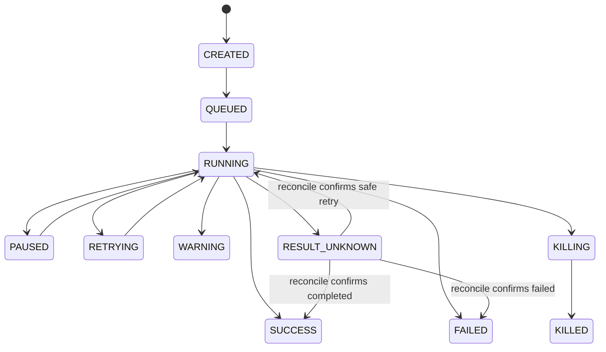

# keel System Design

## 1. 领域模型

| Entity | 用途 / 关键关系 |
|---|---|
| Project | 交付项目；绑定模板版本、环境、权限范围 |
| ProjectTemplateRevision | 型号、服务器/网络基线、BOM 映射、参数默认值、Flow 蓝图、门禁策略；发布后不可变 |
| SourceDocument | 原始开局文件，记录项目、上传人、SHA-256、对象存储 key、状态 |
| SourceCell | 文件/Sheet/坐标/表头/原始值/公式/解析类型；连接标准字段候选 |
| FieldMappingRevision | 源列 → 标准字段、转换器、适用范围、状态、审批和版本 |
| BOMImportBatch | 批次号、项目、模板版本、包摘要、状态、统计、提交版本 |
| BOMImportIssue | 级别、规则 ID、文件/行/字段/单元格、原值、期望、建议和处置状态 |
| BOMItem | 统一物料实体；`category` 区分 server/nic/gpu/psu/bmc/switch/port/optic_module/cable/other |
| DeviceModelRevision | 已发布型号与能力矩阵；BOM 工程校验引用它 |
| NetworkBaselineRevision | 已商定网络配置基线；不得由 AI 生成或擅自补齐 |
| PhysicalPort / Cable | 稳定物理端口；线缆引用两端端口 UID |
| MappingRevision | Mapping发布 发布的 GPU-NIC-端口-交换机映射不可变快照 |
| GateEvidence | 对象、门禁、`PASS/FAIL/BLOCKED/WAIVED`、证据引用、规则版本、采集时间、过期时间 |
| FlowRevision / Execution / TaskAttempt | 作业定义、运行实例、单任务尝试和结果 |
| PushJob | 网络配置计划、审批、执行、复采和回滚状态 |
| ConfigSetRevision / MediaArtifact | 配置意图和已批准介质的版本引用与摘要 |
| Issue / ApprovalRecord / AuditEvent | 故障处置、审批链和不可抵赖的审计事件 |
| Lease | 对设备/通信组的资源租约、fencing token 和过期时间 |
| Rack / RackPlacement / RackDiagramRevision | 机柜实体、U 位放置和不可变图纸版本；引用 BOM/型号/规则版本，缺失信息不猜测 |

## 2. 身份与唯一性

- 有序列号实体唯一键：`(category, serial)`。
- 端口唯一键：`(parent_uid, port_index)`；breakout 子口独立记录。
- 线缆唯一键：`(category, sorted(endpoint_a_uid, endpoint_b_uid))`。
- `bom_line_no` 仅用于导入来源和报错定位，不作为身份键。
- `item_uid` 创建后不可变；位置、hostname、项目归属变更不改变物理身份。RMA 新实物创建新 UID，旧身份保留历史。

## 3. BOM 导入状态机

```text
UPLOADED -> PARSING -> MAPPING -> VALIDATING
                                | BLOCK issues -> REVIEW_REQUIRED
                                | ambiguity/warn -> REVIEW_REQUIRED
                                | no blocking/required review -> READY_TO_COMMIT
REVIEW_REQUIRED -> EDITED -> VALIDATING
READY_TO_COMMIT -> COMMITTING -> COMMITTED
Any non-terminal -> FAILED or CANCELLED (with audit)
```

状态迁移由后端服务控制。上传返回 `import_id`；解析、AI 映射、校验均为异步任务。每个阶段写入阶段结果与可恢复 checkpoint。失败后只重试失败阶段，不重复创建正式 BOM。提交使用事务与唯一约束保护。`COMMITTED` 后数据版本不可原地改写；修改通过新批次/新版本执行。

## 4. 解析和映射规则

1. `WorkbookParser` 读取 workbook/sheet/row/column/cell、合并区域、公式与缓存值。
2. `TableRegionDetector` 按连续区域、合并标题、重复表头和内容分布识别候选表区；不依赖固定第一行表头。
3. `MappingResolver` 应用模板规则、别名、确定性转换器；仅未命中项调用 AI。
4. AI 输出严格 JSON：候选字段、原始来源位置、归一值、理由、置信度、歧义列表；不允许额外字段或工具执行。
5. `Canonicalizer` 负责类型与格式转换，不做业务猜测。单位转换必须来自显式规则。
6. `ValidationEngine` 执行字段、引用、工程三层规则；错误定位到原文件/Sheet/单元格/标准实体。
7. `ReviewService` 支持单项/批量确认，保存修改人、前后值、原因、时间和 mapping revision。
8. `PackageBuilder` 输出 BOM 标准包和 manifest；`BOMCommitService` 只接受通过校验与审核的 revision。

置信度只作为排序信号，不作为唯一放行条件。关键身份、链路两端、端口、型号冲突必须确定性通过或人工确认。

## 5. 统一 BOM 包

标准目录包：

```text
bom-import-package/
  manifest.json
  server/servers.csv
  server/server_components.csv
  server/server_ports.csv
  fabric/switches.csv
  fabric/switch_ports.csv
  fabric/optic_modules.csv
  fabric/cables.csv
  network_baseline/                 # optional, approved baseline only
  address_plan.csv                  # optional, reference only
  credential_batches.csv            # optional, vault references only
```

manifest 必须声明 project/batch/template revision/schema/file list/column list/file digest。标准包七个实体 CSV 都须声明且存在，允许零行但必须通过项目完整性规则。服务器和网络物料同一批次、同一事务提交。凭据文件只含 Vault 引用，禁止明文密码、token、私钥。

单文件宽表只作为服务器物料兼容入口；按 SN 分组折叠为 server + component/port，不得解锁网络就绪或跨域线序检查。

## 6. 规则引擎

- `FORMAT`: 类型、必填、枚举、编码、行号、schema、重复列。
- `REFERENCE`: SN/MAC 唯一性、父对象、型号版本、端口、线缆两端、模板和基线引用。
- `ENGINEERING`: breakout/端口型号能力、光模块速率/介质、上下行带宽比、rail 与机型拓扑、机柜 U 位冲突等。
- Severity: `BLOCK` 禁止提交；`WARN` 必须进入问题清单并按项目策略确认；`INFO` 记录。
- 规则必须有 `rule_id`、版本、判定对象、输入字段、结果、说明、定位信息。规则来源必须是已批准规范、型号能力或项目模板。

## 7. 门禁与网络配置状态

检查结果统一四值：`PASS/FAIL/BLOCKED/WAIVED`。每条证据带 `subject_ref`、`gate_id`、`rule_revision`、`observed_at`、`valid_until`、`source`、`evidence_refs`。过期证据不可用于放行。动态网络就绪默认 TTL 30 秒。

网络就绪在开局配置之后、装机之前，检查NP-1/NP-2/NP-4；NP-3由装机后的验机线序任务产生，不得形成装机循环依赖。NP-5/NP-6为NCCL网络测试前置。缺失或不可采集为BLOCKED/unknown。

PushJob 的唯一状态机：`CREATED/PRECHECKING/BLOCKED/READY/APPROVED/REJECTED/EXECUTING/VERIFYING/COMPLETED/PARTIAL/ROLLING_BACK/ROLLED_BACK/ARCHIVED`。PRECHECKING 未通过不能 READY；未审批不能 EXECUTING；下发后必须复采复比。未知副作用先对账再重试。

## 8. 作业可靠性

- 业务状态与 Outbox 事件在同一数据库事务提交。
- 消费端以 `event_id`、`execution_id`、`task_attempt` 去重。
- 设备独占任务（重装、刷写、生产配置下发、清理、电源操作）获取 Lease + fencing token。
- 任务回执先落库后 ACK；断连/超时无法确定副作用结果时置 `result_unknown`。
- Retry policy 必须区分可安全重试、需对账和禁止自动重试三类。

## 9. 数据保留与审计

原始开局文件、标准 BOM、映射版本、校验报告、审核差异、模板/规则版本、执行参数快照、设备命令、审批和导出均可追溯。秘密值不进入审计正文，使用脱敏摘要或 Vault reference。删除采用软删除/退役；已被历史执行引用的对象不得物理删除。

## 8. Flow 批量脚本执行与监控（Kestra-inspired）

### 8.1 业务模型
- `Flow`: 可版本化的执行定义；核心字段为名称、描述、目标类型、脚本/命令、参数 schema、触发方式、频率、timeout、retry policy、concurrency、failure policy、审批策略、版本状态。
- `Execution`: 一次运行实例；冻结 Flow revision、项目、目标快照、参数快照、触发来源、启动人和关联 BOM/CMDB IDs。
- `TaskRun` / `TaskAttempt`: 每个目标或步骤的执行与重试尝试，保存 started/finished/duration/exit_code/state/error summary。
- `ExecutionLog`: 分级、时间戳、目标、attempt、source；大日志分页/游标读取，支持下载。
- `ExecutionArtifact`: 输出文件、stdout/stderr 摘要、结构化结果、校验和。
- `Schedule`: 频率表达式、时区、启停、next_run_at、last_run_at；计划触发生成新 Execution，不覆盖旧记录。

### 8.2 执行状态



状态必须与现有 PRD 执行状态契约协调；若现有状态枚举不同，更新 API/PRD/本设计同一批，不得私自另起第二套状态机。对副作用命令，连接断开不等于命令失败，必须进入结果核对状态。

### 8.3 Kestra 风格交互契约
- Flow 列表：名称、目标类型、版本、启用状态、最近执行、成功率、定时频率、创建人。
- Flow 详情：Definition/版本历史/Executions/Schedules；Run 按钮打开冻结范围与参数确认面板。
- Execution 详情：Overview（KPI + Gantt）、Topology（任务节点状态）、Targets（大规模虚拟表格）、Logs（级别/目标/时间过滤）、Outputs（产物）、关联（BOM/CMDB/Issue/Gate）。
- 执行操作：Pause/Resume/Kill/Retry failed targets；按钮根据状态、权限和目标生命周期启用/禁用并解释原因。
- 频率显示时区、cron/interval 表达式、下次运行、最近运行；禁止仅展示原始 cron 字符串。

## 9. CMDB 全链自动沉淀

### 9.1 原则
- CMDB 不作为每个模块的第二套业务写入表；各业务域写权威实体并在同事务写 Outbox。
- CMDB projector 消费事件，维护统一资产视图、关系、生命周期 timeline、source/provenance 和当前状态；按 `event_id` 幂等。
- 第一个事件从 BOM 导入任务创建开始，记录原文件 hash、项目、上传者、模板/映射版本、解析结果与来源位置索引。原文件内容仍在受控对象存储，不复制秘密到 CMDB。

### 9.2 必须自动关联的来源

`BOMImport → BOMBatch → BOMItem → Device/Component/PhysicalPort → CollectionSnapshot → Flow/Execution/TaskAttempt → GateEvidence/MappingRevision/ConfigSet/PushJob → Issue/TestReport/Approval → Delivery/CleanupRun → maintained`。

每个 CMDB 记录至少能查到：实体稳定 ID、项目范围、实体类型、当前状态、来源事件、创建/更新时间、关联实体、原始证据引用、版本引用和权限范围。事件投影失败进入重试队列并告警；支持按事件 ID 重放；重放不得重复创建关系。

### 9.3 更新与删除
- 历史事件与证据不可被新版本覆盖；当前态可更新，但 timeline 保留变化。
- 退役/RMA/位置变更采用生命周期事件，不物理删除历史身份。
- CMDB 查询读模型延迟必须可观测；写入成功但投影未完成时标明 `projection_pending`，不可伪称完整。

## 12. Rack Diagram 生成与版本设计

完整规则见 `RACK-DIAGRAM.md`。生成器为确定性领域服务：相同输入版本、规则版本和生成器版本必须生成相同布局摘要。输入缺字段时输出 issue，不调用 AI 猜 U 位/设备高度。

状态：`draft → validating → review_required | ready_to_publish → published → superseded`；异步生成任务状态与图纸状态分离。生成失败不修改当前 published revision。手工 placement 是带 `manual_override=true` 的草稿修改；再次生成时默认保留并产生 diff，只有用户明确选择 reset 才丢弃。

发布前校验：机柜/U 位范围、U 高度、占位冲突、设备重复、型号引用、full-depth 正反面一致性、端口/线缆端点引用。缺失的功耗/重量/散热参数输出 `unknown`，不得假装通过。

CMDB 关系：Rack → RackPlacement → BOMItem/Device；Cable → PhysicalPort → Device。RackDiagramRevision、placement change、publish/export 产生生命周期事件；投影失败可重放。机柜图不直接覆盖 BOM 导入的原始事实，也不把显示标签作为关系键。

## OPS-2026-10-29 · 交付后运维设计增补

### 配置事实与版本依赖
批准基线（复用NetworkBaselineRevision/ConfigSetRevision）→冻结模板渲染IntendedConfig→受控采集ObservedConfig→ConfigDiff（绑定两侧revision、规则版本、阈值和来源）→既有审批/PushJob或服务器配置Job→回读ObservedConfig新快照→限定范围验证报告。实测不可编辑；批准新基线不能回写旧观测。任何目标/基线/意图变化使原diff与审批失效。

### 资产与维护双状态
沿用Device.lifecycle_status；交付CleanupRun成功进入maintained，持续保留查询与允许的运维。MaintenanceState独立表示normal/planned/in_maintenance/repairing/revalidating/retirement_pending/retired；维修不把maintained重置到交付态，也不恢复带内通道。retired为生命周期终态，禁止新采集/执行，历史仍授权可查。RMA新UID并记录替换关系与有效时间。

### 采集与变更任务
CollectionJob复用Job/worker与任务尝试机制；状态queued→running→succeeded|partial|failed|timed_out|cancelled，副作用不明的写任务进入result_unknown且先对账。CollectionPolicy提供schedule、timeout、retry/backoff和freshness_policy引用；自动重试仅针对批准通道的幂等采集。FirmwareUpgradeJob/PowerControlJob复用Execution、Lease、ApprovalRecord和AuditEvent，不提供普通PATCH直接操作设备。

### maintained安全不变式
策略验证先于适配器选择，且每次重试/执行再次验证：Keel直连仅限批准IPMI-only集合，SSH/Agent/Redfish禁止。外部观测必须是独立、已批准的接入来源而非绕路执行器。无法获取时capability/quality/freshness分维度标识，不用零或旧交付报告冒充当前观测。

### 观测与保留
采集结果追加快照；失败保存失败Job和最近成功观测引用，成功时间不前移。LLDP/FDB/ARP/DDM含snapshot_id与ObservationContext，历史分页/时序查询使用专用存储索引。RetentionPolicy和legal_hold约束清理；原文过期后保留hash/版本/关联元数据与expired标识。GateEvidence四值、NP与PushJob原状态机保持不变。

## IA v2.3 · 双平面与统一抽屉

项目切换检查授权→取消旧作用域请求/订阅→关闭旧抽屉→更新上下文与部署URL；跨项目运维不删除其他授权项目数据。批量确认冻结项目、目标、revision，服务端提交时重新检查。抽屉选择、Tab、来源与状态只属于UI投影，不能成为资产第二事实源。维护态 IPMI-only 不因上下文切换改变。

## IA v2.4 实施增补

切换项目取消旧请求、清除旧抽屉；批量确认冻结项目、设备ID与版本。生命周期及IPMI-only不因IA变化而改变。


## IA v2.4 Mock 前端实施记录

导航树、完整页面清单、路由/权限/作用域/加载策略、五/八Tab抽屉与API对照统一见 [IA24-IMPLEMENTATION-MATRIX.md](IA24-IMPLEMENTATION-MATRIX.md)。原FR-0…24、门禁、BOM与维护态规则保留。当前实现为前端Mock，不表示已实现Go/真实设备/真实AI。权威种子为 `fixtures/demo-full-64-b300/demo-seed.json`；原包83集合，补齐与规范化后集合数量以当前manifest为准，主项目硬件数量不变。结构检查、数据修复、契约与交互结果以IA24-*报告为准，无法采集/缺少证据保持unknown或阻断。


## IA24-05 · 用户确认的GPU-NIC默认映射
用户于本轮明确：没有单独说明时，GPU1–8分别对应NIC1–8。对当前B300切片按此规则确认512条GPU-NIC关系，NIC9/10保留存储角色；不再把已有LLDP链路显示成全部unknown。矩阵行GPU、列NIC，点击显示物理端口、线缆、交换机、来源与观测；配对关系与线序/新鲜度判据分开，异常不能被配对规则覆盖。


## 当前六阶段主链路修正

本轮用户明确废弃数字门禁作为主链。当前唯一业务顺序、状态机、逐目标放行、安全交接、独立BOM菜单与API约束以[DELIVERY-LIFECYCLE.md](DELIVERY-LIFECYCLE.md)为准。历史编号只按[DELIVERY-MIGRATION.md](DELIVERY-MIGRATION.md)追溯，不得用于解锁。验机失败关联统一Issues并定向复验；NCCL不反写验机；清理/归档/客户签署齐全后才进入维护态。NP仍是网络内部断言。当前仅前端Mock与契约实现，没有真实设备后端。


## Fabric Topology 增补

物理Cable边和逻辑membership/BGP/containment边不能合并；关联只由显式稳定设备/端口ID建立。planned/observed两种边样式，health五值独立于交付阶段PASS/FAIL。逻辑异常映射至同一端口/Cable/Issue，不能反向改变验机结果。历史快照不可变，找不到at版本不使用当前数据代替。

完整导航、模型、交互、API表与实施边界见[FABRIC-TOPOLOGY.md](FABRIC-TOPOLOGY.md)。


## 无损网络分层证据 v2

批准baseline→applied→operational→counter/test分别存储，NVUE列分层解释。Verdict与capability/freshness/applicability分开。设备/端口/方向/SP/TC/PG/pool/路径/流量/窗口不可混同；同窗口增量处理重启/清零/回绕/缺测。配置/拓扑版本变化失效，最新有效窗口不删除历史失败；同时间冲突证据BLOCKED。

规则/官方章节/命令/版本/判据/证据对照、历史迁移、真实缺口见[LOSSLESS-EVIDENCE.md](LOSSLESS-EVIDENCE.md)。


## CMDB 全链路资产档案增补

CMDB档案只聚合既有领域事实与稳定ID。关系按position/composition/physical/logical/business分类，planned/observed独立；一跳/渐进展开且节点有上限。配置基线、Intended、actual、operational分开，未知不代填。生命周期六阶段后继续维护/换件/退役，历史实体不当作当前库存重复项。

唯一详细设计与模型边界见[CMDB-DOSSIER.md](CMDB-DOSSIER.md)。

## BOM 真实开发增补

用户已授权在 `dev/` 真实实现 BOM 模块。数据与权限边界、版本/审核/Outbox、真实六步工作台及运行验收统一见 [BOM-REAL-DESIGN.md](BOM-REAL-DESIGN.md)。FR-2.1 和唯一 BOM/资产身份保持；其他模块的 Mock 状态不因本模块接入而视为后端已完成。实际通过范围以 BOM-REAL-ACCEPTANCE.json 为准。
