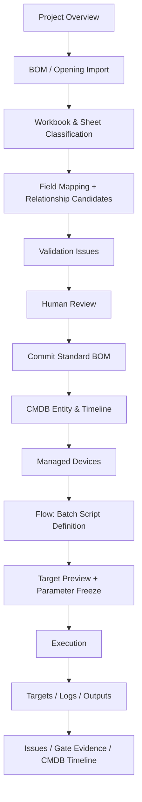
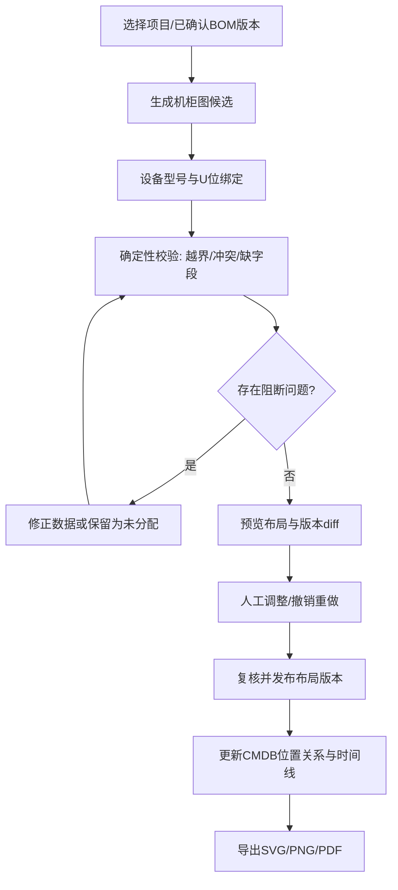
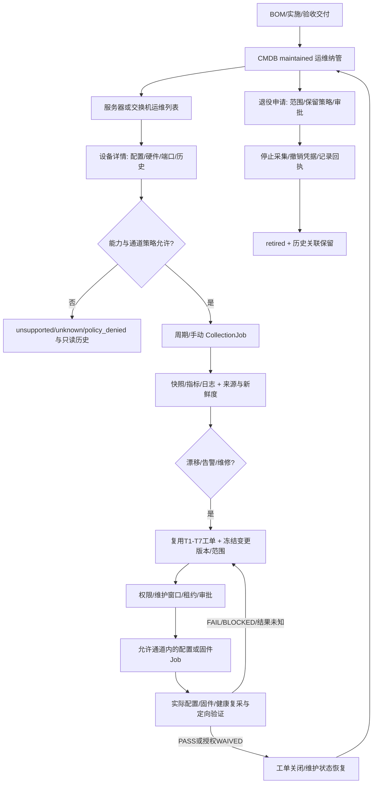

# ke el UI flows (Mermaid)



## Rack Diagram 自动生成流程



## OPS-2026-10-29 · 交付后运维设计增补



所有节点受maintained/IPMI-only限制；维修、审批、重试、升级和回滚不包含恢复SSH/Agent/Redfish的隐藏步骤。交付CleanupRun与最终退役是两条不同流程。

## IA v2.3 · 双平面与统一抽屉

IA v2.3 流程：顶栏或部署项目目录→同一 switchProject→取消旧项目请求与SSE→新部署路由；运维默认过滤更新但允许清除。端口异常↔事件↔工单↔处置↔定向重验证↔关闭，携带授权项目、资产、证据及返回路径。详情抽屉不嵌套。

## IA v2.4 实施增补

设备异常→事件→告警→工单→分派→处置→定向复验→关闭；项目切换双入口共享上下文；全局机房→单柜编辑器。


## IA v2.4 Mock 前端实施记录

导航树、完整页面清单、路由/权限/作用域/加载策略、五/八Tab抽屉与API对照统一见 [IA24-IMPLEMENTATION-MATRIX.md](IA24-IMPLEMENTATION-MATRIX.md)。原FR-0…24、门禁、BOM与维护态规则保留。当前实现为前端Mock，不表示已实现Go/真实设备/真实AI。权威种子为 `fixtures/demo-full-64-b300/demo-seed.json`；原包83集合，补齐与规范化后集合数量以当前manifest为准，主项目硬件数量不变。结构检查、数据修复、契约与交互结果以IA24-*报告为准，无法采集/缺少证据保持unknown或阻断。


## IA24-05 · 用户确认的GPU-NIC默认映射
用户于本轮明确：没有单独说明时，GPU1–8分别对应NIC1–8。对当前B300切片按此规则确认512条GPU-NIC关系，NIC9/10保留存储角色；不再把已有LLDP链路显示成全部unknown。矩阵行GPU、列NIC，点击显示物理端口、线缆、交换机、来源与观测；配对关系与线序/新鲜度判据分开，异常不能被配对规则覆盖。


## 当前六阶段主链路修正

本轮用户明确废弃数字门禁作为主链。当前唯一业务顺序、状态机、逐目标放行、安全交接、独立BOM菜单与API约束以[DELIVERY-LIFECYCLE.md](DELIVERY-LIFECYCLE.md)为准。历史编号只按[DELIVERY-MIGRATION.md](DELIVERY-MIGRATION.md)追溯，不得用于解锁。验机失败关联统一Issues并定向复验；NCCL不反写验机；清理/归档/客户签署齐全后才进入维护态。NP仍是网络内部断言。当前仅前端Mock与契约实现，没有真实设备后端。


## 单柜详情工作区增补

固定单柜窄画布、左侧层级导航和右侧八Tab为本轮布局要求；交互、API、元数据、Mock来源及待执行验收见[RACK-WORKSPACE.md](RACK-WORKSPACE.md)。资产/位置和既有安全模型不变。右侧按需加载，不以缺失指标显示正常。当前构建/浏览器验证按用户安排等待统一执行。


## Fabric Topology 增补

Fabric→Topology→物理全局分组→机柜/Pod展开→设备/端口/线缆→双端证据；线缆→明确逻辑网络→配置Diff/BGP异常→物理设备/端口→统一Issues→处置/定向复验。逻辑网络无关联时unknown，不能凭物理连线补造。切换视图保留scope/filter/focus，URL支持返回。

完整导航、模型、交互、API表与实施边界见[FABRIC-TOPOLOGY.md](FABRIC-TOPOLOGY.md)。


## 无损网络分层证据 v2

Fabric无损选择设备/反例→端口→rule@version→五层证据→读取固定Mock快照并自动关联确认异常→整改产生新证据→定向复验→当前证据与绑定版本有效才关闭Issue。人工关闭不恢复PASS，过期/配置变动必须重验。

规则/官方章节/命令/版本/判据/证据对照、历史迁移、真实缺口见[LOSSLESS-EVIDENCE.md](LOSSLESS-EVIDENCE.md)。


## CMDB 全链路资产档案增补

资产搜索→统一抽屉；目录/树选中→关系展开NIC→端口→Cable→对端交换机→既有八Tab抽屉。配置版本Diff→字段来源→原领域快照/采集/Execution/Issue；生命周期→验机/NCCL/历史退场归档；质量→待审核导入或采集；人工备注白名单/版本校验→审计。保存视图恢复过滤与选中上下文。

唯一详细设计与模型边界见[CMDB-DOSSIER.md](CMDB-DOSSIER.md)。

## BOM 真实开发增补

用户已授权在 `dev/` 真实实现 BOM 模块。数据与权限边界、版本/审核/Outbox、真实六步工作台及运行验收统一见 [BOM-REAL-DESIGN.md](BOM-REAL-DESIGN.md)。FR-2.1 和唯一 BOM/资产身份保持；其他模块的 Mock 状态不因本模块接入而视为后端已完成。实际通过范围以 BOM-REAL-ACCEPTANCE.json 为准。

## 2026-10-30 · 认证、成员与审批闭环

访问业务URL→无Session跳统一登录→本地身份验证→加载授权项目→返回原URL；越权project_id返回403。管理员创建用户→项目成员选择角色/范围/有效期→授权审计→对应账号可访问；撤销/禁用后旧Session下一次请求被拒绝。操作申请冻结版本/目标→独立签署→执行前校验；Critical NH待决阻断。BOM保持六步，不出现独立登录表单。详见 IDENTITY-RBAC.md。

## CMDB 接入原交互

资源树/目录→同一资产→关系/来源/生命周期保持原URL上下文；设备仍打开既有ServerDetailDrawer五Tab、NetworkDeviceDrawer八Tab。生命周期增补版本Diff和变更草稿→独立审核→发布；配置区附Schema属性分组。物理/逻辑网络与机柜位置跳转现有模块，禁止重复建详情或拓扑引擎。

接口对照、模型与实现边界统一见 [CMDB-REAL-DESIGN.md](CMDB-REAL-DESIGN.md)，具体HTTP Schema以openapi.yaml为准。

## 项目与 AI 配置真实落地

部署项目创建成功→新项目BOM工作台；系统管理AI Provider→选择协议/地址/模型/密钥→保存→主动连接与JSON测试→启用/默认；智能开局选择Provider或Rules。字段分行、配置列表与表单分栏，复用既有样式，不嵌套详情对话框。

唯一详细说明与API对照见 [PROJECT-AI-CONFIGURATION.md](PROJECT-AI-CONFIGURATION.md)。

## 系统管理导航修正与全局演示场景退役

/admin统一进入/admin/users；身份管理与其他系统设置共用同一份14项导航，身份页不再渲染局部七项菜单，切换子页清理详情状态。全局演示场景入口、弹窗、注入状态、假延迟和数据重置已删除；原始数据包中的历史场景资料不装载进运行时，不作为有效API契约。业务模拟仍明确保留各领域边界。


## BOM 四步工作台增补（2026-10-30）

用户显式选择 AI/固定→上传→按类别/状态核查→选中确认→冻结范围提交→查看正式版本与 CMDB 发布；错误定位来源行，修正撤销确认并重验；AI 部分入库后剩余记录保留。

完整行为、状态和数据边界见 [BOM-WORKBENCH-V2.md](BOM-WORKBENCH-V2.md)。


## 当前 BOM AI 四阶段工作流

上传→后端真实分析进度→分类审核（交换机及端接优先）→冻结范围确认入库。固定模式不再是当前页面入口。失败继续未完成分析；人工编辑、排除/恢复、批量确认在同一工作台，来源和端口在同一 Dialog 内切换，禁止叠层。详见 [BOM-WORKBENCH-V2.md](BOM-WORKBENCH-V2.md)。


## 2026-10-31 数据中心可视化增补

新增运维 `/topology` 与真实 CMDB 机柜工作台；投影接口、布局/事实边界、asset.relocate 审核发布、验证记录和未完成项统一见 [DATACENTER-VISUALIZATION.md](DATACENTER-VISUALIZATION.md)，HTTP schema 见 openapi.yaml。沿用原资产身份和权限，不把计划连接或 synthetic 数据视为真机验证。


## 2026-10-31 Sidebar 入口整理

```text
部署交付：项目 → 开局配置 → 网络/配置 → 装机 → 验机/网络测试 → NCCL → 退场
运维中心：运维总览、服务器舰队、数据中心拓扑、CMDB、监控、工单、工作流、AI
  数据中心拓扑：全局拓扑、网络架构、机柜管理、物理布线、链路追踪、数据质量
系统管理：平台设置及原管理子页面
```

机柜只在数据中心拓扑组内有一个入口，点击后仍使用 /racks，详情使用 /racks/:rackId。页面与入口统一，不保留旧 Rack 页分支。模块子菜单随当前路径展开，支持手动收起；当前机柜详情同时定位其上级分组和机柜管理子项。收藏和窄栏模式保留，收藏按钮在悬停/键盘聚焦/已收藏时显示。


### 页面空间与导航去重

模块页面切换统一由 Sidebar 承担，删除全局 ModuleNavigation 和 CMDB/拓扑中的重复模块切换栏。设备、Execution、机柜详情内部的对象 Tab 保留。CMDB 通过 Sidebar 切换时保留当前资产和筛选 query。

内容区不再显示“跨项目运维 / on-demand / REAL API”等开发元数据，也不再重复项目筛选整行说明。运维数据范围在顶栏通过“当前项目 / 全部项目”切换，项目由已有 ProjectSwitcher 选择。拓扑正文只留紧凑标题、必要筛选/操作及工作区；无资产时在工作区内显示短空态和有效按钮，演示来源用标题旁短标识保留。

2026-10-31 机柜入口去重：内容区机柜导航仅在机柜管理/详情显示，拓扑、网络、布线、追踪、质量视图不再重复渲染机柜列表。设备与线缆详情的机柜链接按稳定 ID 携带 project_id、selected 及适用 port，定位具体机柜/U 位；已处于该机柜时不显示自跳转链接。Sidebar 保留唯一通用管理入口。

直接定位修复：应用 URL 中 project_id 时先等待目标过滤完成，不以旧上下文覆盖 URL；之后才同步顶栏过滤变更。链接指向其他已授权项目时顶栏显示“指定项目”，完整范围名放在提示中，不误称当前项目。

## 2026-10-31 · 可视化核线工作流 V3

全局 Pod / 局部矩阵 → Fabric 角色束 → 原始成员或 Bipartite → Connection Matrix 单元格 → BioFabric端口列/端口面板 → Cable双端证据 → Metro物理段 → 关联支路树与证据表。URL携带稳定scope、asset、port、cable、row/col；图形只切换表达，不创建资产或路径。缺端记录单独可查，逻辑证据不足停止追踪。详细四页流程、状态和回跳规则以 [topology.md §4](topology.md#4-四个模块的页面设计v3-权威方向) 为唯一说明。本轮只改隔离原型，机柜流程不变。

## 2026-10-31 · Gallery → Dual → Mapping

机柜阵列搜索/Pod筛选 → 同一 ID 的前后双面 → 选择设备 → Mapping 登记端口 → Cable 双端 → 既有布线矩阵/链路追踪。选择、叠加层和筛选写 URL；实装对比缺快照时只提供来源与缺口入口。展示草稿保存不触发 CMDB 变更。详见 [rack-visualization.md](rack-visualization.md)，本次只替换独立 5181 原型。


## Flows 包重构实施增补 · 2026-10-31

入口Flows→创建/模板→Visual或YAML→校验/保存→选择CMDB目标→脚本/通道→真实预检→冻结确认→Execution→失败目标新执行；Files/Triggers/Revisions在Flow详情上下文。

详见 [Flows 实施记录](flows-redesign/implementation.md)、[真实 API 契约](api/flows.md)。字段/Schema仅定义于OpenAPI。
